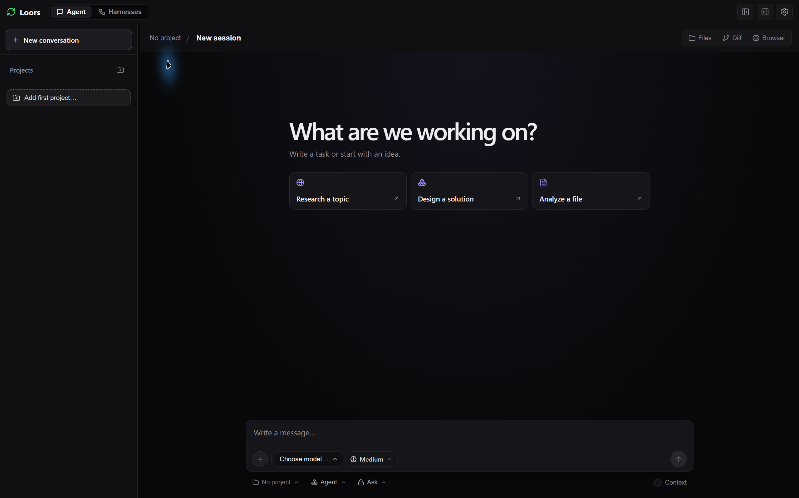
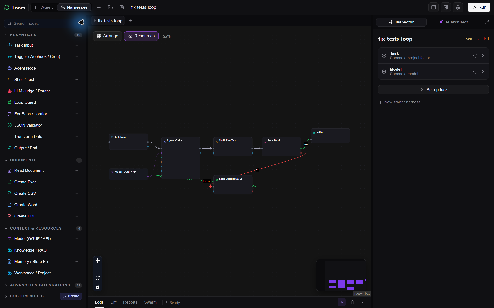

<div align="center">
  
  <h1>Loors</h1>
  <p><strong>Local-first AI Agent, Visual Cyclic Harness Studio &amp; Headless Server</strong></p>
  <p>
    Run autonomous coding &amp; research agents, design cyclic multi-step AI workflows, browse interactively alongside your agent, and deploy headlessly on any server — powered by 100% local GGUF models (embedded <code>llama.cpp</code>) or your favorite cloud APIs.
  </p>

  <p>
    <a href="LICENSE"></a>
    
    
    
    
  </p>

  <p>
    <a href="#features">Features</a> ·
    <a href="#screenshots">Screenshots</a> ·
    <a href="#headless-cli--web-server">Headless CLI &amp; Server</a> ·
    <a href="#installation">Installation</a> ·
    <a href="#architecture">Architecture</a> ·
    <a href="#building-from-source">Build from Source</a> ·
    <a href="CONTRIBUTING.md">Contributing</a>
  </p>
</div>

## Why Loors?

Most AI tools force you to choose between a simple chat window and brittle CLI scripts — or lock you into a single cloud provider. **Loors** brings desktop polish, visual cyclic harnesses, an interactive shared browser, and a headless server binary together in a lightweight native stack (~4.4 MB desktop installer):

- **Agent Mode** — A clean, Codex/Cursor-inspired workspace with file tree, live Git diff, **interactive embedded browser**, subagents, live checklists, persistent artifacts, global MCP servers, 4-tier safety permissions, and live model-context usage.
- **Visual Harness Studio** — Build repeatable, **cyclic** agent loops (e.g., *Coder → Tests → LLM Judge → Loop Guard → Human Gate → Done*) with `For Each` iterators, `JSON Validator`, global run budgets, *Run from here* resume, webhooks, cron, and Telegram triggers.
- **AI Architect** — Built-in assistant that inspects your workspace and designs or refactors `.loors.json` harnesses for you.
- **Headless Agent, CLI & Self-Hosted Web Panel (`loors-cli`)** — Run an agent from a terminal, optionally in an isolated Git worktree, select a local inference backend and context size, then review the saved session in the desktop app. Also execute harnesses in CI/CD, cron, or SSH, or launch the web panel with Bearer token auth and SSE streaming.
- **Local AI or Cloud APIs — Your Choice** — Run 100% private local GGUF models with 1-click `llama.cpp` GPU installation (CUDA, Vulkan, Metal, CPU), dynamic Hugging Face discovery, or connect OpenAI, Anthropic (Claude), Google Gemini, GitHub Models/Copilot, OpenRouter, LM Studio, Ollama, or any custom endpoint.

---

## Features

| Area | Capabilities |
| :--- | :--- |
| **Local Inference (`llama.cpp`)** | Automatic GPU detection (CUDA / Vulkan / Metal / CPU), 1-click runtime download, **dynamic Hugging Face GGUF explorer** (Trending, Most Downloaded, Most Liked, Most Recent), automatic LM Studio local model detection, custom `llama-server` binary support, KV-cache & context tuning, and live VRAM load/unload progress. |
| **Cloud & Local API Providers** | Native streaming SSE for **OpenAI / ChatGPT**, **Anthropic / Claude** (including extended thinking & tool use), **Google Gemini**, **GitHub Models / Copilot**, **OpenRouter / OpenCode**, dedicated **LM Studio** (`:1234`) & **Ollama** (`:11434`) with selectable OpenAI/Anthropic compatibility & optional server secret, and custom endpoints. Automatic `/models` discovery + `${ENV_VAR}` secret expansion. |
| **Autonomous Agent Mode** | 4-tier safety permissions (**Read-only**, **Ask**, **Auto** with AI safety reviewer, **Turbo**), isolated & parallel subagents, live todo checklist, background process manager, scheduled tasks, interactive user questions, persistent Markdown/HTML artifacts, global MCP servers, Thinking/Effort selector, and live context counter for local-model context tracking. |
| **Interactive Embedded Browser** | Pure-Rust Chrome DevTools Protocol (CDP) browser with Chrome-style tabs, editable omnibox, direct click/type/scroll forwarding, and a persistent profile shared live between you and the AI Agent (log in manually and let the agent continue on the same authenticated page). Zero Node.js or Playwright dependencies. |
| **Cyclic Visual Harnesses** | Drag-and-drop React Flow canvas with `Agent`, `Shell / Test`, `For Each / Iterator`, `JSON Validator`, `LLM Judge`, `Loop Guard`, `Human Gate`, `Git Checkpoint`, `Context Compactor`, `Knowledge / RAG`, `Memory / State`, `HTTP Request`, `Notify`, `Trigger` (Webhook / Cron / Telegram), `MCP Server`, `Skills`, `Parallel Fan-Out`, `Subgraph`, and `Custom Nodes` — plus global run budgets, per-node latency badges, 1-click resource wiring, and *Run from here* resume. |
| **Headless Agent, CLI & Web Server** | Dedicated `loors-cli` binary sharing 100% of the Rust engine: run an agent with a GGUF or cloud model, choose `--backend` and per-slot `--context`, optionally isolate changes in a Git worktree, and review the saved conversation in desktop Agent Mode. It also runs harnesses one-shot (`run --jsonl` / `--quiet`), hosts the React Web Panel over HTTP + SSE, and exposes run-control REST APIs. |

---

## Screenshots

### Agent Mode
A focused workspace for starting agent conversations, choosing a model, and opening a project.
<p align="center">
  
</p>

### Visual Harness Studio
Build cyclic workflows on a visual canvas, connect agent and test nodes, and inspect the harness setup.
<p align="center">
  
</p>

---

## Headless CLI & Web Server

Loors ships with a dedicated headless binary (`loors-cli`) for servers, SSH, cron jobs, and CI/CD pipelines:

```bash
# Start an agent from committed HEAD in an isolated worktree, using llama.cpp Vulkan
loors-cli agent --worktree --model /path/to/model.gguf --backend vulkan --context 16384 "Fix the failing test"

# Run a harness once (with optional overrides & structured JSONL output)
loors-cli run ./my-harness.loors.json --workspace ./repo --prompt "Fix failing tests" --jsonl

# Print only the final output (great for Unix pipes)
loors-cli run ./my-harness.loors.json --quiet

# Start the headless HTTP/SSE server + full Web Panel (localhost by default)
loors-cli serve --port 7700

# Expose on a server / LAN (automatically enforces Bearer token authentication)
loors-cli serve --host 0.0.0.0 --port 7700 --token "$LOORS_TOKEN"

# Inspect server state
loors-cli status
loors-cli workflows
loors-cli models
```

The agent asks before running commands or editing files. It prints the session ID and workspace path, and saves the conversation in Agent Mode for desktop review. With `--worktree`, Loors creates an isolated worktree from committed `HEAD` and keeps it after the CLI exits so you can inspect the diff. `--backend` selects `auto`, `cuda`, `vulkan`, `metal`, or `cpu`; `--context` sets the requested token window for each local agent slot. Use `cloud::provider/model` with `--model` for cloud APIs. You can set `LOORS_MODEL` to reuse a model across runs.

| Exit Code | Meaning |
| :--- | :--- |
| `0` | Harness completed successfully |
| `1` | Harness failed or configuration error |
| `2` | Run budget (`--timeout` / `--max-llm-calls`) or Loop Guard exhausted |
| `130` | Interrupted (`Ctrl+C`) with clean `llama-server` and browser shutdown |

---

## Installation

### Prebuilt Installers
Download the latest installer for your operating system from [**GitHub Releases**](../../releases):
- **Windows**: `Loors_*_x64-setup.exe` (branded NSIS installer) or `.msi`
- **macOS**: `Loors_*_aarch64.dmg`
- **Linux**: `Loors_*.AppImage` or `.deb`

> **Windows signing notice:** The current Windows installers and Loors executable are unsigned. Microsoft Defender SmartScreen may show an unknown publisher warning, and Smart App Control on Windows 11 may block installation or launch.

On first launch, choose either:
1. **100% Local AI** — Click **"Install llama.cpp automatically (1 click)"** to detect your GPU and download the inference engine, then download or reuse any GGUF model.
2. **External / Local API** — Open **Settings → APIs / Cloud**, expand a provider (OpenAI, Anthropic, Gemini, GitHub, OpenRouter, LM Studio, Ollama, or Custom), enter your key/URL, and click **"Connect & load models"**.

---

## Building from Source

### Prerequisites
- **Node.js** 20+
- **Rust** stable toolchain (`cargo`, `rustc`)
- [Tauri v2 platform prerequisites](https://v2.tauri.app/start/prerequisites/)

### Development
```bash
npm install
npm run tauri dev
```

### Production Build, CLI & Installers
```bash
# Type-check & build frontend (dist/)
npm run build

# Build headless CLI & server binary
cargo build --release --bin loors-cli --manifest-path src-tauri/Cargo.toml

# Run Rust test suite
cargo test --manifest-path src-tauri/Cargo.toml

# Build native desktop installer for your OS
npm run tauri build
```

---

## Architecture

```text
loors/
├── src/                                  # React 19 + TypeScript + React Flow + Zustand UI
│   ├── lib/bridge.ts                     # Unified Tauri IPC / Web HTTP+SSE transport adapter
│   ├── components/
│   │   ├── AgentWorkspaceView.tsx        # Autonomous Agent Mode UI
│   │   ├── InteractiveBrowserPane.tsx    # Chrome-style interactive embedded CDP browser
│   │   ├── WebAuthGate.tsx               # Bearer token login modal for headless web mode
│   │   ├── SettingsModal.tsx             # Unified General, Models, APIs, MCP, Runtime & Updates
│   │   ├── ModelsModal.tsx               # Local GGUF, dynamic HF explorer & API provider drawer
│   │   ├── ArchitectChat.tsx             # AI Architect visual workflow assistant
│   │   └── Inspector.tsx                 # Node inspector, tool presets & 1-click wiring
│   ├── store/useGraphStore.ts            # Reactive canvas, layout, model & i18n state
│   └── i18n.ts                           # English (default) & Spanish translations
├── src-tauri/                            # Rust + Tauri v2 native backend
│   └── src/
│       ├── bin/loors-cli.rs              # Headless CLI & self-hosted web server entrypoint
│       ├── headless.rs                   # Unified RPC dispatcher, HTTP/SSE server & CLI runner
│       ├── agent_chat/                   # Autonomous agent loop, subagents, permissions & artifacts
│       ├── architect/                    # AI Architect graph designer + read-only workspace tools
│       ├── engine/                       # Cyclic harness executor, For Each, Validator, Judge & RAG
│       ├── inference/                    # Embedded llama.cpp manager + Cloud/Anthropic/OpenAI SSE
│       ├── mcp/                          # Global & per-node Model Context Protocol (stdio) client
│       ├── runtime/                      # GPU detection, llama.cpp auto-installer & custom binary
│       ├── tools/                        # File ops, shell, pure-Rust interactive CDP browser, bg tasks
│       ├── triggers/                     # Webhook HTTP, Cron interval & Telegram Bot triggers
│       └── updater.rs                    # Native GitHub Releases auto-updater
├── .github/workflows/
│   ├── ci.yml                            # PR & push CI (frontend build + Rust tests + loors-cli)
│   └── release.yml                       # Multi-OS release builds + SignPath Windows code signing
└── docs/                                 # Logo & showcase screenshots
```

---

## Keyboard Shortcuts

| Shortcut | Action |
| :--- | :--- |
| `Ctrl + 1` | Switch to **Agent** mode |
| `Ctrl + 2` | Switch to **Harnesses** studio |
| `Ctrl + B` | Toggle left sidebar |
| `Ctrl + Shift + B` | Toggle right panel |
| `Ctrl + J` | Toggle bottom console (Harnesses) |

---

## Contributing, Security & Code Signing

- Read [CONTRIBUTING.md](CONTRIBUTING.md) to get started with pull requests.
- Please follow our [Code of Conduct](CODE_OF_CONDUCT.md).
- To report a security issue or review our privacy & signing policy, see [SECURITY.md](SECURITY.md).

## License

Loors is licensed under the [Functional Source License, Version 1.1, MIT Future License (FSL-1.1-MIT)](LICENSE).

You are free to use, modify, and self-host Loors for personal, internal business, educational, and non-competing purposes. Offering Loors (or a derivative) as a competing commercial product or hosted service requires a commercial license. Each version automatically converts to the MIT License two years after its release.
